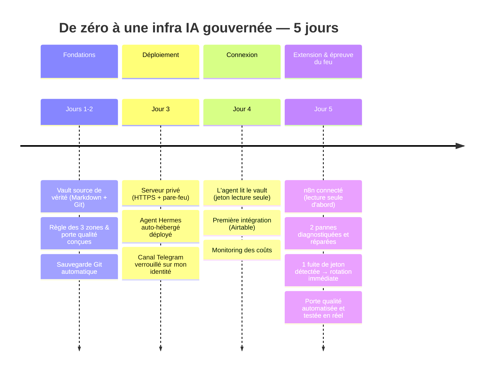
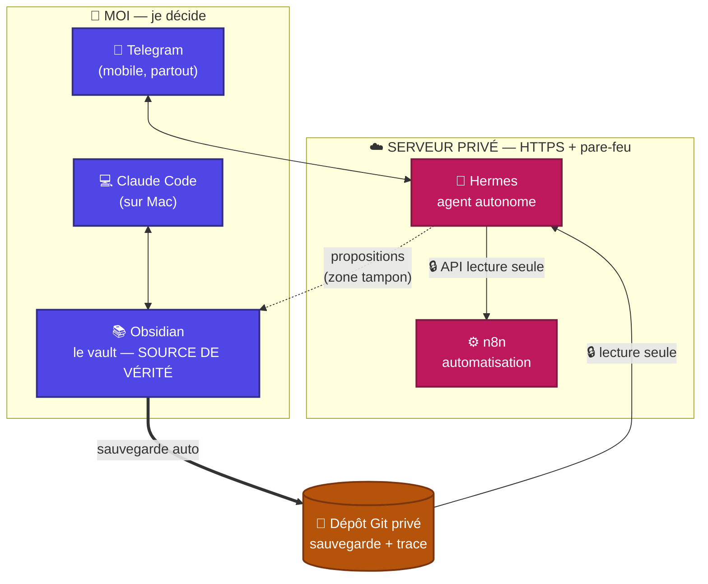
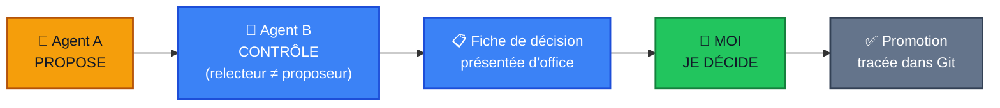

# 🧠 Infra IA personnelle

### *« Je pilote, l'IA code. »*

**Comment un Delivery Manager non-développeur a conçu, livré et gouverné une infrastructure d'agents IA auto-hébergés — seul, en 5 jours.**

-475569?style=flat-square)

---

## 💡 L'idée en 30 secondes

J'ai construit une infrastructure IA personnelle dont le cœur n'est pas la technique, mais la **gouvernance** :

- 📚 Une **source de vérité unique** (un vault de notes Markdown) que tous mes assistants IA lisent — je n'explique jamais deux fois qui je suis, mes règles ou mes projets.
- 🤖 Un **agent autonome auto-hébergé** (Hermes, de NousResearch) sur un serveur privé, joignable depuis mon téléphone, qui me connaît via ce vault et agit sous des règles strictes.
- 🛡️ Un système où **les agents proposent, les contrôles sont automatiques, et l'humain décide** — jamais l'inverse.

Le tout **sans écrire une ligne de code moi-même** : j'ai conçu, décidé, challengé et validé — les IA ont exécuté.

## 📊 Le chantier en chiffres

| | | | |
|:---:|:---:|:---:|:---:|
| **5 jours** de l'idée à l'infra gouvernée | **0 ligne** de code écrite à la main | **2 agents IA** gouvernés en relecture croisée | **4 services** intégrés (vault, Telegram, Airtable, n8n) |
| **9 secrets** gérés sans jamais transiter par un chat | **4 incidents réels** résolus et durcis en règles | **9 décisions ADR** tracées avec leur pourquoi | **~200 $/mois** de dérive évitée par calcul de trajectoire |

## 🗓️ La frise du chantier

👉 **Le récit complet du chantier, pannes comprises : [le journal de bord](docs/journal-de-bord.md)** — c'est là que se voit le travail.

## 🏗️ Architecture

Les agents accèdent au vault en **lecture seule** (jeton scopé au strict nécessaire). Leurs propositions passent par une **zone tampon** et une **porte qualité automatisée** avant d'entrer dans la vérité :

## 🧭 Les principes

1. 🛡️ **Sécurité first, non négociable.** Toute action sortante exige ma validation explicite. Un secret ne transite **jamais** par un chat — dépôt direct dans la configuration, en saisie masquée.
2. 📚 **Une seule source de vérité.** Le vault prime sur tout. Les outils qui savent le lire reçoivent un *pointeur* (« lis le vault, il prime ») ; les autres une copie subordonnée. Jamais deux vérités qui divergent.
3. 🔒 **Moindre privilège.** Chaque agent reçoit un secret scopé et révocable par service — jamais plus que le strict nécessaire (ex. : n8n connecté en lecture seule d'abord, élargi seulement après preuve d'usage).
4. ⚖️ **Le système contrôle, l'humain décide.** Relecture croisée automatique entre agents, fiche de décision prête à trancher. Je n'ai jamais à y penser — mais c'est toujours moi qui tranche.
5. 💸 **Efficience des tokens.** Chaque dépense d'IA doit être justifiée : déclenchements événementiels plutôt que minuteurs, routage des tâches vers le bon modèle économique, seuils chiffrés.
6. 🔓 **Réversibilité.** Markdown + Git partout : aucun enfermement propriétaire, tout est portable et l'historique fait preuve.

## ⚡ Ce que ça change au quotidien

- 📱 Depuis mon téléphone : « Rappelle-moi mon focus actuel » → l'agent relit le vault et répond avec **mon** contexte, à jour.
- 🧠 Mes assistants connaissent mes règles **avant** que je tape le premier mot — chargées automatiquement à chaque session.
- 🔄 Un agent repère une amélioration → un second la **contrôle** → je reçois une **fiche de décision** prête à valider.
- ⚙️ Mes automatisations n8n sont consultables par l'agent — en lecture seule tant que l'usage n'a pas justifié plus.

## 📖 La documentation

| Document | Ce qu'il raconte |
|---|---|
| 📓 **[Journal de bord](docs/journal-de-bord.md)** | **Le chantier, jour par jour** — ce qui a été construit, ce qui a cassé, comment ça a été réparé. La preuve par le récit. |
| 🛡️ [Gouvernance](docs/gouvernance.md) | La règle des 3 zones, la porte qualité automatisée, et les **4 incidents réels** avec les règles qui en sont sorties |
| 📋 [Journal de décisions](docs/decisions.md) | 9 décisions d'architecture au format ADR — le *pourquoi* derrière chaque choix |
| 💸 [Coûts](docs/couts.md) | L'économie réelle d'une infra IA personnelle : calibrage mesuré, pièges, règles d'efficience |

## 🚀 Statut & suite

🟢 **Opérationnelle** (montée en juin 2026) et en évolution continue. Prochaines étapes : veille automatisée (digest quotidien sur mobile), délégation de développement à un agent codeur, étude d'un rapatriement sur machine locale.

## 👤 À propos

Je suis **Vincent Granouillit** — Delivery Manager / Chef de projet (France & Suisse), en route vers le *product building* augmenté à l'IA. Cette infra est à la fois mon outil quotidien et ma preuve de concept : **la gouvernance du delivery appliquée aux systèmes d'agents.**

🔗 **[vincent-granouillit.vercel.app](https://vincent-granouillit.vercel.app)**
