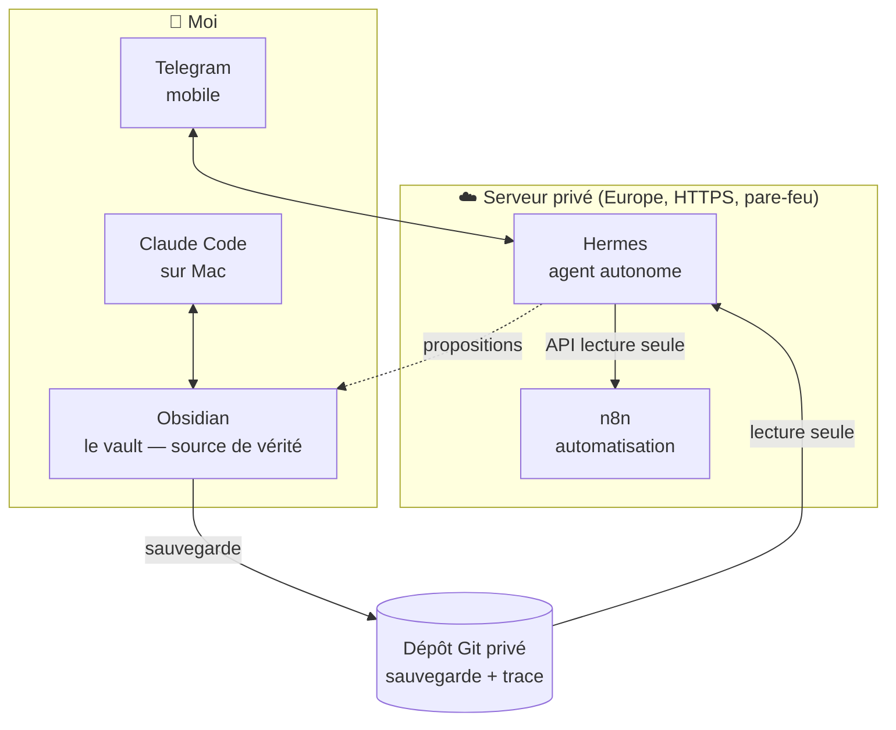

# Infra IA personnelle — « Je pilote, l'IA code »

> Comment un Delivery Manager **non-développeur** conçoit, sécurise et gouverne une infrastructure d'agents IA auto-hébergés — avec les méthodes du delivery : règles explicites, porte qualité, journal de décisions, et maîtrise des coûts.

## L'idée en 30 secondes

J'ai construit une infrastructure IA personnelle dont le cœur n'est pas la technique, mais la **gouvernance** :

- Une **source de vérité unique** (un vault de notes en Markdown) que tous mes assistants IA lisent — je n'explique jamais deux fois qui je suis, mes règles ou mes projets.
- Un **agent autonome auto-hébergé** (Hermes, de NousResearch) sur un serveur privé, joignable depuis mon téléphone, qui me connaît via ce vault et agit sous des règles strictes.
- Un système où **les agents proposent, les contrôles sont automatiques, et l'humain décide** — jamais l'inverse.

Le tout piloté sans écrire une ligne de code moi-même : mon principe directeur est **« je pilote, l'IA code »**.

## Architecture

Les agents accèdent au vault en **lecture seule** (jeton scopé au strict nécessaire). Leurs propositions d'enrichissement passent par une **zone tampon** et une **porte qualité** avant d'entrer dans la vérité — voir [la gouvernance](docs/gouvernance.md).

## Les principes

1. **Sécurité first, non négociable.** Toute action sortante (publier, supprimer, agir sur le serveur) exige ma validation explicite. Un secret ne transite **jamais** par un chat — dépôt direct dans la configuration, en saisie masquée.
2. **Une seule source de vérité.** Le vault prime sur tout. Les outils qui savent le lire reçoivent un *pointeur* (« lis le vault, il prime ») ; les autres une copie subordonnée. Jamais deux vérités qui divergent.
3. **Moindre privilège.** Chaque agent reçoit un secret scopé et révocable par service — jamais plus que le strict nécessaire (ex. : n8n connecté en lecture seule d'abord, élargi seulement après preuve d'usage).
4. **Le système contrôle, l'humain décide.** Les propositions des agents sont relues automatiquement par un *autre* agent (relecteur ≠ proposeur), qui produit une fiche de décision. Je n'ai jamais à y penser — mais c'est toujours moi qui tranche.
5. **Efficience des tokens.** Chaque dépense d'IA doit être justifiée : déclenchements événementiels plutôt que minuteurs, routage des tâches vers le bon outil, budget suivi. Détail dans [les coûts](docs/couts.md).
6. **Réversibilité.** Markdown + Git partout : aucun enfermement propriétaire, tout est portable et l'historique fait preuve.

## Ce que ça change au quotidien

- Depuis mon téléphone : « Rappelle-moi mon focus actuel » → l'agent relit le vault et répond avec **mon** contexte, à jour.
- Mes assistants connaissent mes règles de travail **avant** que je tape le premier mot — elles sont chargées automatiquement à chaque session.
- Quand un agent repère une amélioration possible de ma base de connaissances, il la **propose** ; un second agent la **contrôle** ; je reçois une **fiche de décision** prête à valider.
- Mes workflows d'automatisation (n8n) sont consultables et bientôt pilotables par l'agent — en lecture seule tant que l'usage n'a pas justifié plus.

## La documentation

| Document | Ce qu'il raconte |
|---|---|
| [Gouvernance](docs/gouvernance.md) | La règle des 3 zones, la porte qualité automatisée, et les **incidents réels** (et ce qu'ils ont appris au système) |
| [Journal de décisions](docs/decisions.md) | Les décisions d'architecture au format ADR — le *pourquoi* derrière chaque choix |
| [Coûts](docs/couts.md) | L'économie réelle d'une infra IA personnelle : calibrage, pièges (la fuite à 200 $/mois évitée), règles d'efficience |

## Statut

🟢 **Opérationnelle** (montée en juin 2026) et en évolution continue. Prochaines étapes : veille automatisée (digest quotidien), délégation de développement à un agent codeur, et étude d'un rapatriement sur machine locale.

## À propos

Je suis **Vincent Granouillit** — Delivery Manager / Chef de projet (France & Suisse), en route vers le *product building* augmenté à l'IA. Cette infra est à la fois mon outil quotidien et ma preuve de concept : la gouvernance du delivery appliquée aux systèmes d'agents.

🔗 [vincent-granouillit.vercel.app](https://vincent-granouillit.vercel.app)
