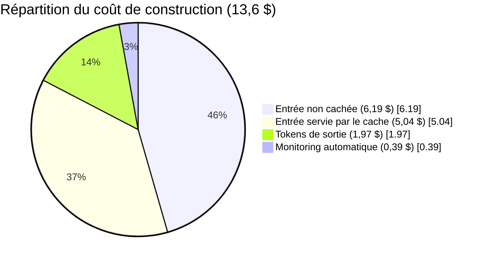
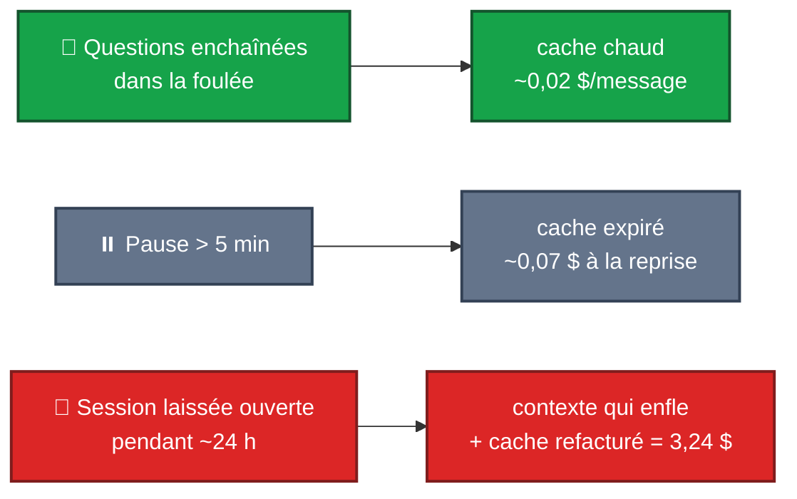

# 💸 Les coûts réels d'une infra IA personnelle

> [!NOTE]
> Un sujet que presque personne ne documente : **combien coûte vraiment un agent IA autonome**, et comment on gouverne cette dépense. Chiffres **mesurés** sur mon installation (modèle Claude Sonnet via API, juin 2026) — pas des estimations de plaquette.

---

## 📏 Le calibrage mesuré

| Événement | Coût mesuré |
|---|---|
| 🚀 Démarrage d'une session (l'agent recharge mes règles depuis le vault, ~20 000 tokens) | **~0,15 $** |
| 💬 Chaque message suivant dans la même session (cache actif à ~99 %) | **~0,02-0,05 $** |
| ⏸️ Reprise après plus de 5 min de pause (cache expiré) | **~0,07 $** |
| 🖼️ Une capture d'écran analysée par l'agent | **~0,44 $** |
| 🤖 Passage de monitoring automatique | **~0,07 $** |

## 📊 Où part l'argent — mes 2 jours de construction (13 $)

> [!NOTE]
> **13 $ pour deux jours, c'est un coût de chantier, pas de croisière** : l'agent réparait, installait, développait et déboguait. Les profils mensuels réels :

| Profil d'usage | Coût |
|---|---|
| 🌙 Minimal (questions ponctuelles + monitoring plafonné) | **~5-10 $/mois** |
| 💬 Conversationnel normal | **~15-30 $/mois** |
| 🏗️ Construction intensive (l'agent développe, débogue, installe) | **~100 $/mois** |

## ⚡ La mécanique du cache — le levier n°1

L'API facture l'entrée « fraîche » **10× plus cher** que l'entrée servie par le cache (~5 min de durée de vie). Mesuré sur mes sessions : taux de cache moyen **~87 %**, qui divise le coût d'entrée réel par **~4**.

Trois règles pratiques, mesurées :

- ✅ **Enchaîner ses questions** dans la foulée = optimal.
- ✅ **Un sujet = une session.** Contre-intuitif mais mesuré : une session laissée ouverte ~24 h a coûté **3,24 $**, alors qu'une **session neuve coûte 0,06 $**. Repartir de zéro est l'option économique.
- ❌ L'astuce « pinger l'agent toutes les 4 minutes pour garder le cache chaud » est une fausse bonne idée : on paie en continu pour économiser parfois.

## 🚨 L'incident fondateur : la fuite silencieuse à 200 $/mois

> [!WARNING]
> Un agent autonome avait créé **de lui-même** une tâche de surveillance toutes les 15 minutes. Coût unitaire dérisoire : 0,07 $. Trajectoire réelle :
>
> **4 passages/h × 24 h × 30 jours × 0,07 $ ≈ 200 $/mois** — plus que tout le reste de l'infra réuni.
>
> Aucun symptôme, aucune alerte : c'est un **calcul de trajectoire**, pas un signal, qui l'a révélée.

Les règles qui en sont sorties :

1. ⛔ **Aucune tâche récurrente créée par un agent sans accord humain explicite.** Une dépense récurrente est une décision humaine.
2. 📉 Le monitoring est **plafonné** (2 passages/jour ≈ 4 $/mois) — l'événementiel prime sur le minuteur.
3. 🧮 **Tout chiffre produit par un LLM est contre-vérifié** par un calcul indépendant : le même agent avait estimé un coût avec une erreur de facteur **1000** (faute de conversion), présentée avec un aplomb parfait.

## 🧭 Le routage économique des tâches

Tous les canaux IA n'ont pas le même modèle de facturation — alors chaque tâche va vers le bon guichet :

| Tâche | Outil | Pourquoi |
|---|---|---|
| 📚 Analyses lourdes, rédaction, travail de fond | Assistant sous **abonnement** (forfait) | Le volume de tokens n'augmente pas la facture |
| ⚙️ Action sur le serveur, pilotage mobile, automatisations | Agent auto-hébergé (**API**, au token) | Sa valeur propre — réservée à ce que lui seul sait faire |
| 🖼️ Captures d'écran, images | Assistant sous abonnement | 0,44 $ l'image côté API |

> [!IMPORTANT]
> **La leçon transverse : le coût d'un système d'agents se gouverne comme sa sécurité** — par des règles écrites et des seuils chiffrés, jamais par de la vigilance au fil de l'eau.

---

📓 [Journal de bord](journal-de-bord.md) · 🛡️ [Gouvernance](gouvernance.md) · 📋 [Décisions](decisions.md) · 🏠 [Retour au README](../README.md)

