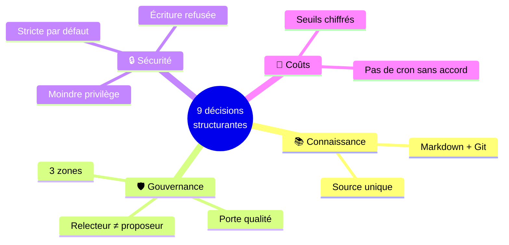

# 📋 Journal de décisions (format ADR)

> [!NOTE]
> Chaque décision structurante est consignée avec son *pourquoi*, pour ne jamais la redébattre — et pour que les agents IA, qui lisent ce journal, **ne proposent pas de la défaire**. Un réflexe de delivery appliqué aux systèmes d'agents : les ADR (*Architecture Decision Records*) ne servent pas qu'aux humains.

## 🗺️ Vue d'ensemble

| ADR | Décision | Domaine |
|---|---|---|
| [01](#adr-01) | Une source de vérité unique, en Markdown, sous Git | 📚 Connaissance |
| [02](#adr-02) | La règle des 3 zones | 🛡️ Gouvernance |
| [03](#adr-03) | Posture sécurité stricte par défaut | 🔐 Sécurité |
| [04](#adr-04) | Porte qualité avec séparation des rôles | ⚖️ Gouvernance |
| [05](#adr-05) | « Pointeur, pas copie » pour les règles | 🧭 Architecture |
| [06](#adr-06) | Lecture seule d'abord, élargi après preuve d'usage | 🔒 Sécurité |
| [07](#adr-07) | Refus d'un accès en écriture des agents au référentiel | 🔒 Sécurité |
| [08](#adr-08) | Gouvernance des coûts par règles et seuils | 💸 Coûts |
| [09](#adr-09) | Canal mobile Telegram, verrouillé sur un seul utilisateur | 📱 Accès |

---

## ADR-01 — Une source de vérité unique, en Markdown, sous Git

**📌 Décision :** toute la connaissance personnelle (profil, règles, projets, décisions) vit dans un vault de notes Markdown, versionné, lu par tous les assistants IA.

> [!NOTE]
> **Pourquoi :** ne jamais réexpliquer son contexte à chaque outil ; rester portable et réversible (aucun format propriétaire) ; l'historique Git fait preuve.

**❌ Alternative écartée :** une architecture « un fait = un fichier » outillée en Python — sur-ingénierie pour un système qu'on veut pilotable par un non-développeur.

## ADR-02 — La règle des 3 zones (validé / à valider / dehors)

**📌 Décision :** les agents ne peuvent enrichir la connaissance qu'en passant par une zone tampon, jamais directement dans la vérité.

> [!NOTE]
> **Pourquoi :** autoriser l'auto-enrichissement par les agents **sans** leur céder la propriété de la vérité ; empêcher qu'une proposition piégée (ou simplement fausse) entre silencieusement dans le référentiel.

## ADR-03 — Posture sécurité stricte par défaut

**📌 Décision :** toute action sortante exige une validation humaine explicite ; en cas de doute l'agent s'arrête et demande. Les assouplissements se décident au cas par cas, sur proposition argumentée (pour/contre/risques).

> [!NOTE]
> **Pourquoi :** l'utilisateur n'est pas technique — il ne peut pas détecter une brèche a posteriori. La règle stricte est le filet de sécurité ; elle se desserre par décisions conscientes, jamais par glissement.

## ADR-04 — Porte qualité avec séparation des rôles

**📌 Décision :** toute proposition d'agent est contrôlée par un **autre** agent (relecteur ≠ proposeur), automatiquement, à chaque démarrage de session ; l'humain reçoit une fiche de décision prête à trancher.

> [!NOTE]
> **Pourquoi :** le contrôle est une responsabilité du système, pas une charge mentale pour l'humain. Un agent qui se relit lui-même ne détecte pas ses propres biais.

## ADR-05 — « Pointeur, pas copie » pour les règles

**📌 Décision :** les outils capables de lire le vault reçoivent un pointeur (« lis-le, il prime ») ; les autres une copie courte avec clause de préséance explicite.

> [!NOTE]
> **Pourquoi :** deux sources de règles divergent inévitablement, et face à une contradiction le comportement d'un LLM est imprévisible. Une seule vérité, déclarée première partout.

## ADR-06 — Accès des agents : lecture seule d'abord, élargi après preuve d'usage

**📌 Décision :** chaque intégration démarre au périmètre minimal (ex. : l'outil d'automatisation connecté en lecture seule, jetons scopés à un seul dépôt/service) ; on élargit seulement quand l'usage le justifie.

> [!NOTE]
> **Pourquoi :** moindre privilège — le rayon d'impact d'une fuite ou d'une erreur reste minuscule ; et on n'accorde pas de pouvoir « au cas où ».

## ADR-07 — Refus d'un accès en écriture des agents au référentiel

**📌 Décision :** demande de l'agent **refusée** — son accès au vault reste en lecture seule, car le jeton d'écriture du fournisseur Git ne sait pas se limiter à la zone tampon.

> [!NOTE]
> **Pourquoi :** un droit qui ne peut pas être scopé au périmètre voulu est un droit trop large. La remontée des propositions passe par un processus hybride (l'agent formule, l'humain transmet, un second agent contrôle) — avec des **seuils chiffrés** qui déclencheront l'automatisation du canal si le volume le justifie.

> [!WARNING]
> **À revisiter :** une machine locale hébergeant agent + vault permettrait d'appliquer la règle des 3 zones par les **permissions du système de fichiers** — ce que Git ne sait pas faire. À l'étude.

## ADR-08 — Gouvernance des coûts par règles et seuils

**📌 Décision :** aucune tâche récurrente créée par un agent sans accord humain ; « un sujet = une session » ; routage des tâches vers l'outil au bon modèle économique ; tout chiffre à enjeu contre-vérifié par un calcul indépendant.

> [!NOTE]
> **Pourquoi :** une dérive de coût d'agent autonome est **silencieuse par nature** (voir l'incident « 200 $/mois » dans [la gouvernance](gouvernance.md)) — elle se prévient par des règles, pas par de la vigilance.

## ADR-09 — Le canal mobile : Telegram, restreint à un seul utilisateur

**📌 Décision :** l'agent est joignable depuis le téléphone via un bot Telegram verrouillé sur l'identité du propriétaire.

> [!NOTE]
> **Pourquoi :** piloter l'infra depuis n'importe où, sans exposer d'interface publique supplémentaire ; l'agent n'obéit qu'à son propriétaire, identité vérifiée.

---

📓 [Journal de bord](journal-de-bord.md) · 🛡️ [Gouvernance](gouvernance.md) · 💸 [Coûts](couts.md) · 🏠 [Retour au README](../README.md)

