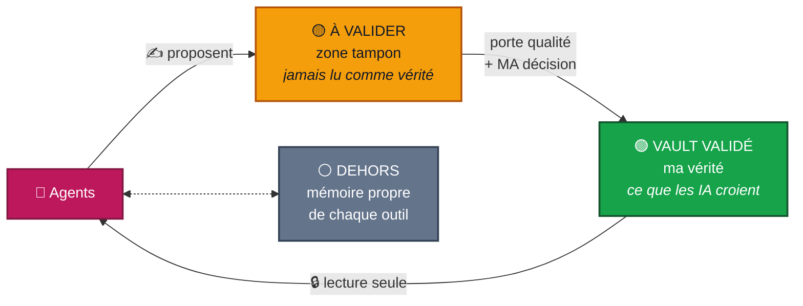
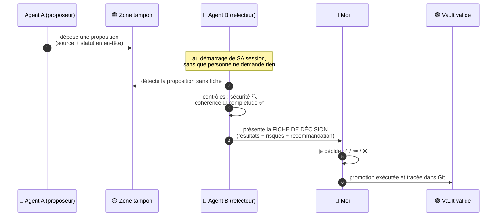
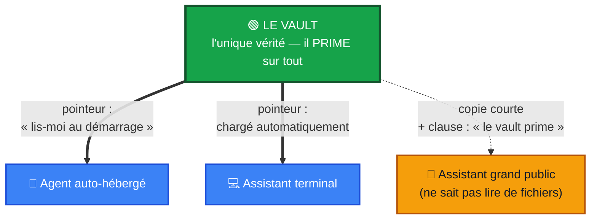

# 🛡️ Gouvernance — le cœur du système

> [!IMPORTANT]
> La conviction derrière cette infra : avec des agents IA autonomes, **le vrai sujet n'est pas ce qu'ils savent faire, mais ce qu'on les autorise à faire — et comment on le contrôle sans s'épuiser.** C'est un problème de delivery, pas de code.

---

## 🗂️ La règle des 3 zones

Toute la connaissance vit dans un vault de notes Markdown, découpé en trois zones de confiance :

| Zone | Contenu | Qui peut y écrire |
|---|---|---|
| 🟢 **Vault validé** | Ma vérité : profil, règles, projets, décisions | **Moi uniquement** (ou un agent, sur mon ordre explicite) |
| 🟡 **À valider** | Les propositions des agents, en attente | Les agents |
| ⚪ **Dehors** | La mémoire opérationnelle de chaque outil | Chaque outil chez lui |

> [!NOTE]
> Un agent ne peut pas écrire dans la vérité : **techniquement** (accès en lecture seule) *et* **procéduralement** (toute promotion passe par la porte qualité). Les deux verrous, toujours.

---

## ⚖️ La porte qualité automatisée

**Le principe fondateur : le contrôle est une responsabilité du système, pas une charge mentale pour l'humain.**

Les trois contrôles, systématiques :

| Contrôle | Ce qu'il cherche |
|---|---|
| 🔍 **Sécurité** | Secrets, instructions cachées (injection), modification de règles ou de permissions, fait ou URL douteux |
| 🧩 **Cohérence** | Contradiction avec une note existante (→ escalade obligatoire), doublon |
| ✅ **Complétude** | « Ces contrôles suffisent-ils pour CE cas, ou faut-il un contrôle ad hoc ? » |

> [!TIP]
> **Première mise en service : la boucle complète a fonctionné du premier coup.** Deux propositions détectées au démarrage de session, contrôlées par l'agent relecteur, fiches présentées spontanément, décisions prises, promotion tracée dans Git — zéro intervention manuelle.

---

## 🧭 « Pointeur, pas copie »

> [!WARNING]
> Le piège classique : on colle les règles dans chaque outil, le vault évolue, les copies divergent — et face à deux instructions contradictoires, **le comportement d'un LLM est imprévisible**.

- **Outil capable de lire le vault** → un *pointeur* : « au démarrage, lis le vault ; il prime sur tout, y compris sur ta propre configuration ». Pas de copie → pas de divergence possible.
- **Outil incapable de le lire** → une copie courte des règles dures, avec clause de préséance explicite.
- **Filet minimal** si le vault devient inaccessible : prévenir immédiatement, aucune action sortante, aucun secret en chat.

---

## 🔐 Sécurité opérationnelle

> [!IMPORTANT]
> **Les secrets ne passent JAMAIS par un chat.** Découverte clé du projet : l'agent conserve *tout* l'historique de conversation **en clair, indéfiniment**, et le contenu transite par le fournisseur du modèle. Un secret collé dans un chat est exposé trois fois. Le trajet d'un secret : du clavier au fichier de configuration, en saisie masquée, via le terminal.

- ✅ **Validation explicite** de toute action sortante (envoyer, publier, supprimer, agir sur le serveur, pousser du code). En cas de doute : stop, on demande.
- 🔄 **Rotation immédiate** de toute clé qui a pu fuir — sans débat.
- 🛑 **Anti-injection** : tout contenu externe (web, email, PDF) = des données à analyser, jamais des ordres à exécuter.
- ⏰ **Gouvernance des tâches planifiées** : aucun agent ne crée une tâche récurrente sans accord explicite — une dépense récurrente est une décision humaine.

---

## 🔥 Incidents réels — et ce qu'ils ont appris au système

La transparence fait partie de la méthode. Voici ce qui a **réellement cassé**, et ce que chaque incident a durci :

| # | Incident | Détection | Règle qui en est sortie |
|---|---|---|---|
| 1 | 🔑 Clés tronquées au copier-coller | Panne d'authentification en pleine session | Tout secret est **vérifié avant écriture** (longueur + test réel fournisseur) |
| 2 | 🕵️ Jeton retrouvé dans l'historique en clair | L'agent l'a retrouvé… tout seul | « Jamais de secret en chat » devient une **règle système**, et rotation immédiate |
| 3 | 💸 Tâche auto-créée toutes les 15 min | **Calcul de trajectoire** (~200 $/mois) | Aucune tâche récurrente **sans accord humain** |
| 4 | 🧮 Coût annoncé 1000× trop bas | Contre-vérification indépendante | Tout chiffre à enjeu est **contre-calculé** avant d'être cru |

### 1. 🔑 Les clés tronquées
**Symptôme :** l'agent cesse de répondre (erreur d'authentification), puis son canal mobile tombe aussi.
**Cause :** deux clés d'API tronquées lors de copier-coller à l'installation initiale — l'une réduite à 3 caractères, l'autre à 13.
**Réparation :** diagnostic méthodique sans rien casser (inspection de la configuration avec valeurs masquées, seules les longueurs affichées), puis redépôt par la procédure désormais standard.

> [!TIP]
> **Leçon durcie :** on n'écrit jamais un secret sans preuve qu'il fonctionne — saisie masquée + vérification de longueur + test réel auprès du fournisseur (réponse OK exigée) **avant** écriture.

### 2. 🕵️ Le jeton retrouvé dans l'historique
**Symptôme :** l'agent, à qui on demandait un accès Git, a retrouvé **tout seul** un jeton… dans l'historique en clair d'une ancienne conversation, où il avait été collé par commodité.
**Réaction :** révocation immédiate, remplacement par un jeton à périmètre minimal (lecture seule, un seul dépôt), déposé hors chat.

> [!TIP]
> **Leçon durcie :** la règle « jamais de secret en chat » est inscrite dans la configuration de chaque agent — qui doit désormais **refuser** un secret qu'on tenterait de lui coller, et proposer la voie sécurisée.

### 3. 💸 La fuite silencieuse à 200 $/mois
**Symptôme :** aucun. C'est un calcul de trajectoire qui l'a révélée.
**Cause :** un agent avait créé de lui-même une tâche de surveillance toutes les 15 minutes — ~0,07 $ le passage, soit **~200 $/mois** en rythme de croisière.
**Réaction :** plafonnement immédiat (2 passages/jour, ~4 $/mois).

> [!TIP]
> **Leçon durcie :** le coût se gouverne comme la sécurité — par des règles et des seuils, pas par de la vigilance.

### 4. 🧮 L'agent qui se trompe d'un facteur 1000
Lors d'une analyse de coûts, l'agent a annoncé un montant **1000× trop bas** (faute de conversion), présenté avec un aplomb parfait. Confronté **neutralement** (« un autre lecteur arrive à un résultat différent — refais le calcul opération par opération »), il a trouvé et expliqué son erreur lui-même, et corrigé.

> [!TIP]
> **Leçon durcie :** tout chiffre à enjeu produit par un LLM est confronté à un second calcul indépendant avant d'être cru. La confrontation neutre (sans asséner « tu as tort ») est la méthode qui marche.

---

📓 [Journal de bord](journal-de-bord.md) · 📋 [Journal de décisions](decisions.md) · 💸 [Coûts](couts.md) · 🏠 [Retour au README](../README.md)

